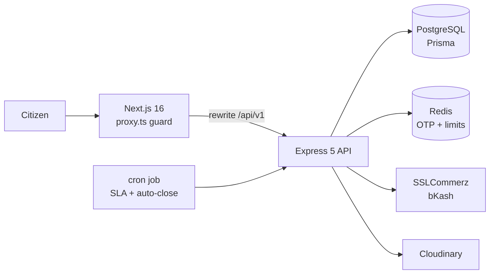
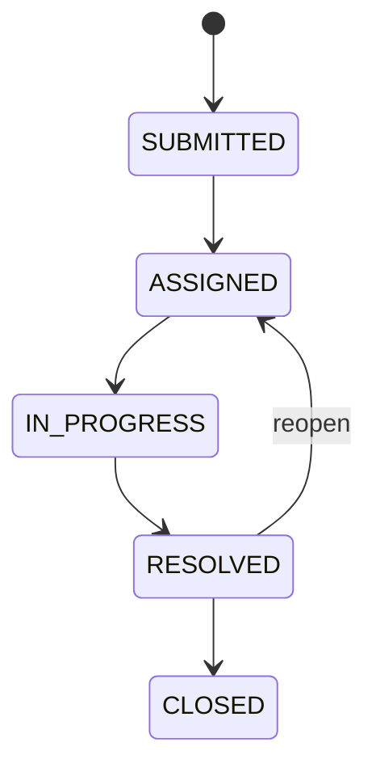

 

# Md Parvez Hasan

### Full Stack Developer &nbsp;|&nbsp; Software Engineer

 

  

<a href="#-about-me">About</a> &nbsp;•&nbsp;
<a href="#-current-activities">Activities</a> &nbsp;•&nbsp;
<a href="#-skills">Skills</a> &nbsp;•&nbsp;
<a href="#-connect-with-me">Connect</a> &nbsp;•&nbsp;
<a href="#-github-stats">Stats</a> &nbsp;•&nbsp;
<a href="#-featured-projects">Projects</a>

 

## 👨‍💻 About Me

I'm a **3rd-year Computer Science & Engineering student at CUET** and a self-taught **Full Stack Developer** from Chattogram, Bangladesh.
I build complete, end-to-end web applications with **Next.js, TypeScript, Node.js and PostgreSQL**, from REST APIs and databases to polished dashboards.
I care about clean architecture, secure authentication, role-based access control and real payment integrations (**Stripe, SSLCommerz, bKash**).
I'm currently looking for a **Junior / Entry-Level Full Stack Developer** role.

 

## 🔭 Current Activities

- 🌱 I'm learning **system design**, **testing** and **backend engineering**
- 🛠️ I'm polishing my full-stack projects with real payment flows and role-based dashboards
- 📘 I'm going deeper into **TypeScript patterns** and clean API architecture
- 🎓 I'm studying **Computer Science & Engineering** at CUET
- 💼 I'm open to **Junior / Full Stack Developer** opportunities
- 💬 Ask me about: **Next.js App Router, Prisma, JWT refresh flows, SSLCommerz & bKash integration**

 

## 🛠️ Skills

| Category | Technologies |
| :--- | :--- |
| **Languages** |  |
| **Frontend** |  |
| **Backend** |  |
| **Databases & ORM** |  |
| **Tools & DevOps** |  |

 

 

## 🌐 Connect With Me

 

## 📊 GitHub Stats

 

## 🚀 Featured Projects

| Project | What it solves | Core stack | Links |
| :--- | :--- | :--- | :--- |
| **🏙️ Nagar Sheba**   Flagship | Citizens report city problems and track them to resolution, with SLA enforcement and online payments | Next.js 16 · TypeScript · TanStack Query · Express 5 · Prisma | [Live](https://nagar-sheba-online.onrender.com) · [Repo](https://github.com/parety308/Nagar-Sheba-Frontend) |
| **🏠 RentNest** | Tenants and landlords connect through a rental marketplace with secure Stripe payments | Next.js · TypeScript · Tailwind · Stripe | [Live](https://rentnest-a5.onrender.com) · [Repo](https://github.com/parety308/RentNest_A5) |
| **🚚 ZapShift** | Parcel booking, delivery tracking and rider coordination for a courier service | React · Tailwind · DaisyUI · Firebase · JWT | [Live](https://simple-firebase-auth-c54cc.web.app) · [Repo](https://github.com/parety308/Zap_Shift_Client) |
| **🍲 LocalChefBazaar** | Home chefs sell meals to customers with ordering and reviews | React · Tailwind · DaisyUI · Firebase · JWT | [Live](https://local-chef-bazaar-online.netlify.app) · [Repo](https://github.com/parety308/Local_Chef_Bazaar_Client) |

 

 

### 🏙️ Nagar Sheba

> **City Complaint & Service Request Platform.** Report it. Track it. See it fixed.

<table>
<tr>
<td width="50%" valign="top">

#### 🧭 How it works

1. A citizen submits a request through a **4-step wizard** with geolocation and upload progress.
2. The request moves through Submitted, Assigned, In Progress, Resolved and Closed.
3. Each request has an **SLA deadline**, and overdue ones are flagged automatically.
4. A **15-minute cron job** auto-closes eligible requests.
5. Citizens pay via SSLCommerz or bKash and get a **PDF receipt**.

</td>
<td width="50%" valign="top">

#### ⚙️ Engineering highlights

- 🔌 **58-endpoint** TypeScript REST API
- 🔐 JWT with **rotating refresh tokens**, Google Sign-In, email OTP
- 👥 **Three-role access control** with a database re-check on every request
- 💳 **Idempotent payment callbacks** with server-side verification and auto-refunds
- 🛡️ **Redis** rate limiting across the API

</td>
</tr>
</table>

<b>🧩 View architecture and request lifecycle</b>

 

 

### 🏠 RentNest

> **Rental Property Marketplace.** Find it. Request it. Pay securely.

<table>
<tr>
<td width="50%" valign="top">

#### 🧭 How it works

- 🔍 **Tenants** browse and filter listings, request rentals, pay via **Stripe Checkout** and leave reviews.
- 🏘️ **Landlords** create listings with image uploads and approve or reject requests.
- 🛡️ **Admins** manage users, moderate listings and oversee all requests.

</td>
<td width="50%" valign="top">

#### ⚙️ Engineering highlights

- 🍪 **Cross-origin auth cookies** solved with a Next.js rewrite proxy
- ⏳ Access-token expiry kept shorter than refresh-token expiry so **silent refresh** never breaks
- 🔀 **Environment-aware API client** for browser and SSR
- 🔔 **Stripe webhook signature verification**

</td>
</tr>
</table>

 

### 🚚 ZapShift

> **Courier & Parcel Delivery Service.** Book it. Track it. Deliver it.

<table>
<tr>
<td width="50%" valign="top">

#### 🧭 How it works

- 📦 Customers book a parcel and pay online, with **dynamic pricing** by type, weight and delivery zone.
- 🚴 **Riders** collect and deliver parcels and confirm with an **OTP**.
- 🗺️ **Admins** assign riders, manage routing and oversee warehouses.

</td>
<td width="50%" valign="top">

#### ⚙️ Engineering highlights

- 🔄 **8-stage parcel lifecycle** synced across three dashboards
- 💰 Rider earnings: **80% in-city, 60% outside-city**
- 🔐 Firebase Authentication with a JWT-secured API

</td>
</tr>
</table>

 

### 🍲 LocalChefBazaar

> **Local Culinary Marketplace.** Fresh, homemade meals from local chefs.

Customers browse daily meals, place orders, save favorites and leave reviews. Chefs manage their own listings and order requests, and admins moderate users and role-change requests.

**Highlights:** Firebase Authentication with a JWT-secured API (Axios interceptor for token handling) · role-based routes for User, Chef and Admin · admin approval flow for role changes · paginated and sortable meal catalog.

 

**⭐ If any of these projects help you, a star keeps me motivated to keep building!**

