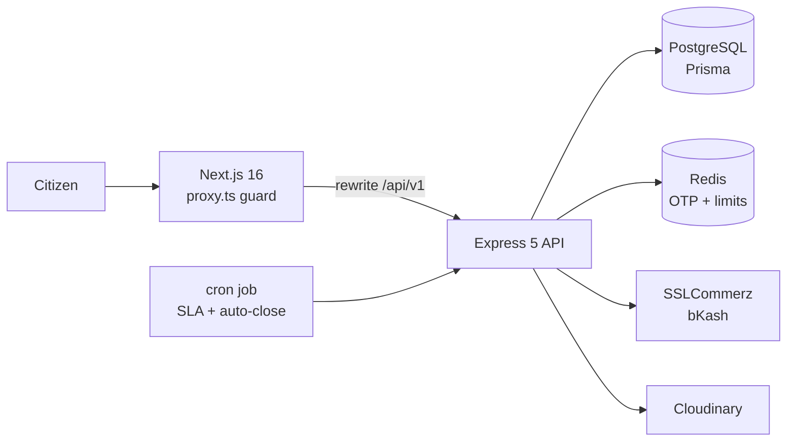
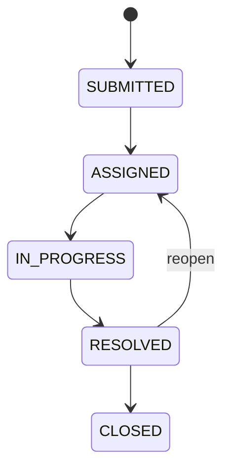

<div align="center">


<br/>

<a href="https://github.com/parety308">
  
</a>

<br/><br/>

<a href="https://www.linkedin.com/in/mdparvezhasan"></a>
<a href="mailto:md.parvez.hasan.dev@gmail.com"></a>
<a href="https://portfolio-sandy-eight-rzxhn4f702.vercel.app/"></a>

<br/>


<br/><br/>

<sub>
<a href="#-about-me">About</a> &nbsp;•&nbsp;
<a href="#-tech-arsenal">Tech</a> &nbsp;•&nbsp;
<a href="#-featured-projects">Projects</a> &nbsp;•&nbsp;
<a href="#-how-i-build">Approach</a> &nbsp;•&nbsp;
<a href="#-github-analytics">Analytics</a> &nbsp;•&nbsp;
<a href="#-contact">Contact</a>
</sub>

</div>

<br/>

## 👨‍💻 About Me

<table>
<tr>
<td width="58%" valign="top">

I'm a **3rd-year CSE student at CUET** and a self-taught **Full Stack Developer** who turns real-world problems into **secure, scalable, production-ready applications**.

I learn by building complete, end-to-end products: REST APIs, databases, payment flows and polished role-based dashboards, rather than following tutorials.

```yaml
name       : Md Parvez Hasan
role       : Full Stack Developer (Next.js + Node.js)
education  : BSc in CSE, CUET (3rd Year)
experience : Full Stack Developer Intern @ Cypher Bangladesh
location   : Chattogram, Bangladesh 🇧🇩
languages  : Bangla (Native), English (Intermediate)
status     : 🟢 Open to Junior / Entry-Level Full Stack roles
```

</td>
<td width="42%" valign="top">

### ⚡ Quick Facts

- 🏗️ **3+ full-stack platforms** shipped end to end
- 🔌 **58-endpoint** TypeScript REST API
- 🔐 **JWT with refresh rotation**, Google OAuth, email OTP
- 💳 **Stripe, SSLCommerz, bKash** integrations
- 🛡️ **Redis rate limiting** and Zod validation
- 🎓 Programming Hero Web Dev, Batch 12

</td>
</tr>
</table>

<br/>

## 🛠️ Tech Arsenal

<div align="center">

| | |
| :--- | :--- |
| **Languages** |  |
| **Frontend** |  |
| **Backend & Data** |  |
| **Tools & Deployment** |  |

<br/>


</div>

<br/>

## 🚀 Featured Projects

<div align="center">

| Project | What it solves | Core stack | Links |
| :--- | :--- | :--- | :--- |
| **🏙️ Nagar Sheba** <br/> <sub>Flagship</sub> | Citizens report city problems and track them to resolution, with SLA enforcement and online payments | Next.js 16 · Express 5 · Prisma · PostgreSQL · Redis | [Live](https://nagar-sheba-online.onrender.com) · [API](https://nagar-sheba.onrender.com) |
| **🏠 RentNest** | Tenants and landlords connect through a rental marketplace with secure Stripe payments | Next.js · Express · Prisma · PostgreSQL · Stripe | [Live](https://rentnest-a5.onrender.com) |
| **🚚 ZapShift** | Parcel booking, delivery tracking and rider coordination for a courier service | React · Express · MongoDB · Firebase · JWT | [Live](https://simple-firebase-auth-c54cc.web.app) |

</div>

<br/>

### 🏙️ Nagar Sheba

> **City Complaint & Service Request Platform.** Report it. Track it. See it fixed.

A civic services platform with three roles: **citizens** submit and track requests, **staff** handle them, and **admins** oversee the whole system.

<table>
<tr>
<td width="50%" valign="top">

#### 🧭 How it works

1. A citizen submits a request through a **4-step wizard** with geolocation, a live map preview and upload progress.
2. The request moves through a lifecycle: Submitted, Assigned, In Progress, Resolved, Closed. A resolved request can be reopened.
3. Every request carries an **SLA deadline**. Overdue ones are flagged automatically.
4. A **15-minute cron job** auto-closes eligible requests.
5. Citizens pay fees via SSLCommerz or bKash and receive a **PDF receipt**.
6. Admins monitor everything through **Recharts dashboards**, CSV export and a full audit log.

</td>
<td width="50%" valign="top">

#### ⚙️ Engineering highlights

- 🔌 **58-endpoint** TypeScript REST API with a route, validation, controller and service structure
- 🔐 JWT with **rotating refresh tokens**, Google Sign-In, email OTP and single-flight token refresh on the client
- 👥 **Three-role access control** enforced at route, layout and UI level, plus a **database re-check on every API request**
- 💳 SSLCommerz and bKash with **server-side verification, idempotent callbacks** and automatic refunds
- 🛡️ **Redis** rate limiting across the whole API surface
- 🌗 Dark mode, URL-synced filters, skeleton loaders, SEO and ISR

</td>
</tr>
</table>

**Stack:** `Next.js 16` · `React 19` · `TypeScript` · `Tailwind v4` · `TanStack Query/Form` · `shadcn/ui` · `Express 5` · `Prisma 7` · `PostgreSQL` · `Redis` · `Zod` · `Recharts` · `Cloudinary` · `SSLCommerz` · `bKash`

[](https://nagar-sheba-online.onrender.com)
[](https://nagar-sheba.onrender.com)
[](https://github.com/parety308/Nagar-Sheba-Frontend)
[](https://github.com/parety308/Nagar-Sheba)

<details>
<summary><b>🧩 View architecture and request lifecycle</b></summary>

<br/>





</details>

<details>
<summary><b>🔥 Hardest problems I solved</b></summary>

<br/>

- **Authentication:** JWT with rotating refresh tokens, Google Sign-In and email OTP, with three-role access control verified against the database so stale tokens never keep old permissions.
- **Payments:** SSLCommerz and bKash callbacks can arrive more than once. Making them idempotent and verifying them server-side prevents double charges and double refunds.
- **Lifecycle and SLA:** Modeling the request lifecycle with deadlines, overdue flagging and a 15-minute cron job that auto-closes requests.
- **Abuse protection:** Redis-backed rate limiting across a 58-endpoint API.

</details>

<br/>

### 🏠 RentNest

> **Rental Property Marketplace.** Find it. Request it. Pay securely.

A marketplace that connects tenants and landlords, with an admin layer for moderation, deployed as **two independent services** (a Next.js frontend and an Express/Prisma backend on separate origins).

<table>
<tr>
<td width="50%" valign="top">

#### 🧭 How it works

- 🔍 **Tenants** browse and filter listings, save favorites, submit rental requests, pay through **Stripe Checkout** and leave reviews.
- 🏘️ **Landlords** create listings with drag-and-drop image uploads and approve or reject incoming rental requests.
- 🛡️ **Admins** manage users, ban accounts, take down listings and oversee all rental requests from one dashboard.

</td>
<td width="50%" valign="top">

#### ⚙️ Engineering highlights

- 🍪 **Cross-origin auth cookies** solved by proxying browser requests through a Next.js rewrite and forwarding cookies on server-side requests
- ⏳ JWT access-token expiry kept shorter than refresh-token expiry so the **silent-refresh flow in middleware** never breaks
- 🔀 An **environment-aware API client**: relative `/api` in the browser, absolute backend URL during SSR and static generation
- 🔔 **Stripe webhook signature verification** in production

</td>
</tr>
</table>

**Stack:** `Next.js 16` · `React 19` · `TypeScript` · `Tailwind v4` · `shadcn/ui` · `React Hook Form` · `Zod` · `Framer Motion` · `Express 5` · `Prisma` · `PostgreSQL` · `JWT` · `Stripe` · `Cloudinary`

[](https://rentnest-a5.onrender.com)
[](https://github.com/parety308/RentNest_A5)
[](https://github.com/parety308/RentNest_A4)

<details>
<summary><b>🔭 What I'd build next</b></summary>

<br/>

- In-app messaging between landlords and tenants
- Map-based property search and filtering
- Additional payment methods beyond Stripe
- An automated end-to-end test suite for the rental request and payment flow

</details>

<br/>

### 🚚 ZapShift

> **Courier & Parcel Delivery Service.** Book it. Track it. Deliver it.

A delivery platform that covers parcel booking, online payment and live status updates, with coordinated dashboards for customers, riders and admins.

<table>
<tr>
<td width="50%" valign="top">

#### 🧭 How it works

- 📦 Customers book a parcel and pay online. **Pricing is calculated dynamically** from parcel type, weight and whether delivery is inside or outside the city. Each parcel gets a 6-digit tracking ID.
- 🚴 **Riders** collect and deliver parcels, update status and confirm both pickup and delivery with an **OTP**.
- 🗺️ **Admins** assign riders, manage inter-district routing and oversee warehouse operations.
- 📈 Role-based dashboards with Recharts.

</td>
<td width="50%" valign="top">

#### ⚙️ Engineering highlights

- 🔄 An **8-stage parcel lifecycle** (unpaid, paid, pickup, in-transit, delivered and more) kept in sync across three dashboards
- 💰 **Rider earnings logic** that differs by route: 80% for in-city and 60% for outside-city deliveries
- 🧮 **Dynamic pricing rules** based on parcel type, weight and delivery zone
- 🔐 Firebase Authentication combined with a JWT-secured API

</td>
</tr>
</table>

**Stack:** `React` · `React Router` · `Tailwind CSS` · `DaisyUI` · `TanStack Query` · `Recharts` · `Node.js` · `Express` · `MongoDB` · `Firebase Auth` · `JWT`

[](https://simple-firebase-auth-c54cc.web.app)
[](https://github.com/parety308/Zap_Shift_Client)
[](https://github.com/parety308/Zap_Shift_Server)

<details>
<summary><b>🔭 What I'd build next</b></summary>

<br/>

- Live map-based rider tracking
- SMS and push notifications on status changes
- Automated rider assignment based on proximity and load
- A customer support and dispute-resolution flow

</details>

<br/>

<div align="center">

<a href="https://github.com/parety308/Nagar-Sheba-Frontend"></a>
<a href="https://github.com/parety308/Nagar-Sheba"></a>
<br/>
<a href="https://github.com/parety308/RentNest_A5"></a>
<a href="https://github.com/parety308/Zap_Shift_Client"></a>

</div>

<br/>

## 🧠 How I Build

| Principle | In practice |
| :--- | :--- |
| 🧱 **Modular architecture** | `route → validation → controller → service` on the backend; `api → hooks → components` on the frontend |
| 🔒 **Security first** | httpOnly cookies, bcrypt, rate limiting, server-side payment verification, open-redirect protection |
| ✅ **Validated end to end** | Zod schemas on both client and server so rules never drift apart |
| ⚡ **Smooth UX** | Skeletons, optimistic updates, URL-synced state, error boundaries, accessibility basics |
| 🚢 **Shipped, not just built** | Everything deployed on Render, Vercel or Netlify with live demos |

<br/>

## 📊 GitHub Analytics

<div align="center">


<br/>


</div>

<br/>

## 🎯 Currently

| | |
| :--- | :--- |
| 🔭 **Building** | Polished full-stack projects with real payment flows and role-based dashboards |
| 📚 **Learning** | System design, testing and deeper TypeScript patterns |
| 🎓 **Studying** | Computer Science & Engineering at **CUET** |
| 💼 **Looking for** | **Junior / Entry-Level Full Stack Developer** opportunities |
| 💬 **Ask me about** | Next.js App Router, Prisma, JWT/refresh flows, SSLCommerz & bKash integration |

<br/>

## 📬 Contact

<div align="center">

**I'm actively looking for Junior / Entry-Level Full Stack roles.**
Got an opportunity or an interesting project? Let's talk. 🤝

<br/>

<a href="https://www.linkedin.com/in/mdparvezhasan"></a>
&nbsp;
<a href="mailto:md.parvez.hasan.dev@gmail.com"></a>
&nbsp;
<a href="https://portfolio-sandy-eight-rzxhn4f702.vercel.app/"></a>

<br/><br/>


**⭐ If any of these projects help you, a star keeps me motivated to keep building!**

</div>
